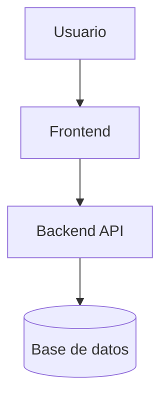

# 📘 Nombre del proyecto

> Tarea 1 Módulo 3 Programación Javascripy y Typescript

---

## 1. Información general

| Campo | Descripción |
|---|---|
| Nombre del proyecto | |
| Versión | |
| Fecha de inicio | |
| Última actualización | |
| Estado | En desarrollo / Finalizado / Pausado |
| Autor(es) | |
| Repositorio | |

### 1.1. Descripción

Explicar brevemente en qué consiste el proyecto, qué problema resuelve y cuál es su finalidad.

### 1.2. Objetivos

- Objetivo general:
- Objetivos específicos:
  - 
  - 
  - 

### 1.3. Alcance del proyecto

**Incluye:**
- 

**No incluye:**
- 

---

## 2. Requisitos del proyecto

### 2.1. Requisitos funcionales

| ID | Requisito | Descripción | Estado |
|---|---|---|---|
| RF-01 | | | Pendiente |
| RF-02 | | | Pendiente |
| RF-03 | | | Pendiente |

### 2.2. Requisitos no funcionales

| ID | Requisito | Descripción |
|---|---|---|
| RNF-01 | Rendimiento | |
| RNF-02 | Seguridad | |
| RNF-03 | Usabilidad | |
| RNF-04 | Mantenibilidad | |

---

## 3. Tecnologías y herramientas

### 3.1. Stack tecnológico

| Tecnología | Versión | Utilización |
|---|---|---|
| | | |
| | | |
| | | |

### 3.2. Herramientas utilizadas

- Editor de código:
- Control de versiones:
- Gestión de bases de datos:
- Testing:
- Despliegue:
- Otras herramientas:

### 3.3. Dependencias principales

| Dependencia | Versión | Propósito |
|---|---|---|
| | | |
| | | |

---

## 4. Arquitectura del proyecto

### 4.1. Descripción de la arquitectura

Explicar el patrón arquitectónico utilizado y la organización general del sistema.

### 4.2. Diagrama de arquitectura

<!-- Insertar aquí el diagrama de arquitectura -->



### 4.3. Estructura de directorios

```text
project/
├── src/
│   ├── components/
│   ├── services/
│   └── ...
├── tests/
├── docs/
├── README.md
└── ...
```

### 4.4. Descripción de módulos

| Módulo | Responsabilidad | Descripción |
|---|---|---|
| | | |
| | | |
| | | |

---

## 5. Instalación y configuración

### 5.1. Requisitos previos

- 
- 
- 

### 5.2. Instalación

```bash
# Clonar el repositorio
git clone URL_DEL_REPOSITORIO

# Acceder al directorio
cd nombre-proyecto

# Instalar dependencias
```

### 5.3. Variables de entorno

| Variable | Descripción | Obligatoria |
|---|---|---|
| | | Sí / No |
| | | Sí / No |

### 5.4. Ejecución del proyecto

```bash
# Comando para iniciar el proyecto
```

---

## 6. Implementación y desarrollo

### 6.1. Funcionalidades implementadas

| ID | Funcionalidad | Descripción | Estado |
|---|---|---|---|
| F-01 | | | Completada |
| F-02 | | | En desarrollo |
| F-03 | | | Pendiente |

### 6.2. Descripción de los componentes principales

#### Componente 1: Nombre

- **Responsabilidad:**
- **Entradas:**
- **Salidas:**
- **Dependencias:**
- **Observaciones:**

#### Componente 2: Nombre

- **Responsabilidad:**
- **Entradas:**
- **Salidas:**
- **Dependencias:**
- **Observaciones:**

### 6.3. API y endpoints

| Método | Endpoint | Descripción | Parámetros |
|---|---|---|---|
| GET | | | |
| POST | | | |
| PUT | | | |
| DELETE | | | |

### 6.4. Modelo de datos

Describir las entidades, relaciones y estructura de la base de datos.

<!-- Insertar diagrama ER o esquema de datos -->

---

## 7. Pruebas y validación

### 7.1. Estrategia de pruebas

Describir los tipos de pruebas realizados.

- [ ] Pruebas unitarias
- [ ] Pruebas de integración
- [ ] Pruebas funcionales
- [ ] Pruebas de aceptación
- [ ] Pruebas de rendimiento
- [ ] Pruebas de seguridad

### 7.2. Registro de pruebas

| ID | Prueba | Resultado esperado | Resultado obtenido | Estado |
|---|---|---|---|---|
| T-01 | | | | |
| T-02 | | | | |

### 7.3. Errores detectados

| ID | Error | Causa | Solución | Estado |
|---|---|---|---|---|
| E-01 | | | | |
| E-02 | | | | |

---

## 8. Observaciones y decisiones técnicas

Registrar aspectos relevantes encontrados durante el desarrollo.

### 8.1. Observaciones generales

- 
- 
- 

### 8.2. Decisiones técnicas

| Fecha | Decisión | Justificación | Impacto |
|---|---|---|---|
| | | | |
| | | | |

### 8.3. Problemas y limitaciones

- **Problema:**
  - Descripción:
  - Impacto:
  - Posible solución:

### 8.4. Aspectos pendientes

- [ ] 
- [ ] 
- [ ] 

---

## 9. Mejoras y trabajo futuro

Identificar oportunidades de mejora y nuevas funcionalidades.

| ID | Mejora propuesta | Prioridad | Complejidad | Estado |
|---|---|---|---|---|
| M-01 | | Alta / Media / Baja | | Pendiente |
| M-02 | | Alta / Media / Baja | | Pendiente |

### 9.1. Recomendaciones

- 
- 
- 

---

## 10. Conclusiones

### 10.1. Resultados obtenidos

Describir los resultados alcanzados respecto a los objetivos iniciales.

### 10.2. Valoración técnica

Evaluar la arquitectura, tecnologías, implementación, rendimiento y mantenibilidad.

### 10.3. Dificultades encontradas

Describir los principales obstáculos durante el desarrollo y cómo se resolvieron.

### 10.4. Aprendizajes

Registrar los conocimientos y experiencias adquiridos.

### 10.5. Conclusión final

Redactar una valoración global del proyecto, su estado actual y su grado de cumplimiento.

---

## 11. Control de versiones y cambios

| Versión | Fecha | Autor | Descripción de los cambios |
|---|---|---|---|
| 1.0.0 | | | Versión inicial |
| | | | |

---

## 12. Referencias y recursos

Documentación, tutoriales, librerías y recursos consultados.

- [Documentación oficial](URL)
- [Recurso 2](URL)
- [Recurso 3](URL)

---

## 13. Licencia

Especificar la licencia del proyecto.

---

**Última actualización:** DD/MM/AAAA
